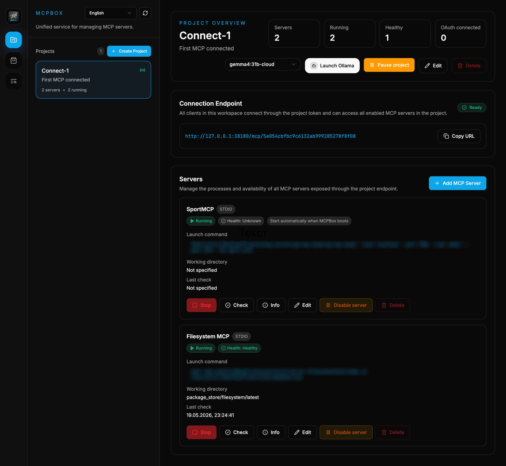
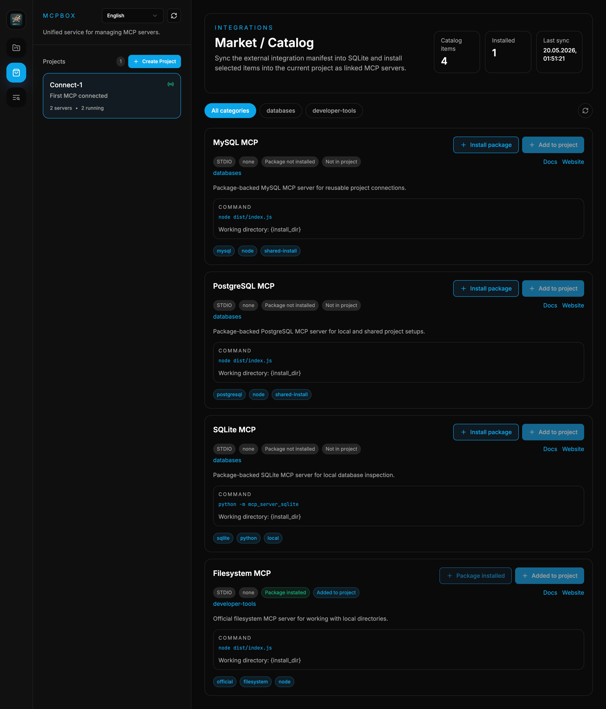
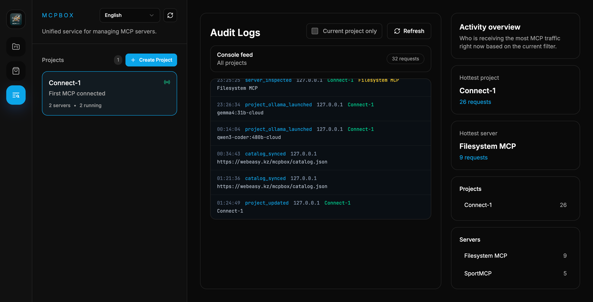

# MCPBox

MCPBox — единое приложение с открытым исходным кодом под Apache-2.0. Включает возможности бывшего MCPBoxPro: пользователей, роли, сессии, токены, OIDC SSO, интеграции PolicyBox/RagBox и настройки хранилища. Коммерческая лицензия и активация не нужны.

Сборка и первый запуск (Go 1.26+, Node.js/npm):

```bash
cd html
npm ci
npm run build
cd ..
GOWORK=off go build -o MCPBox .
./MCPBox admin create --email admin@example.com --password 'replace-with-a-unique-password'
./MCPBox
```

Админка: `http://127.0.0.1:38181/`; MCP проекта: `http://localhost:38182/mcp/<project-token>`. Войдите с созданной учётной записью. При интерактивном запуске приложение также предлагает создать первого администратора.

Перед обновлением существующей установки прочитайте [инструкцию переноса](docs/MERGE.md). Все исходники находятся здесь; папка MCPBoxPro для сборки не нужна. Релиз: `./build-release.sh host` или `./build-release.sh all`.


MCPBox - это control plane на Go для MCP-серверов. Он позволяет группировать локальные и удаленные MCP-бэкенды по проектам, смотреть что они публикуют, отслеживать трафик и отдавать один project URL для Claude, Cursor, Codex, LM Studio и локальных сценариев с Ollama.

<p align="center">
  <a href="images/main.png">
    
  </a>
  <a href="images/market.png">
    
  </a>
  <a href="images/log.png">
    
  </a>
</p>

<p align="center">
  <sub>Нажмите на любой скриншот, чтобы открыть его в полном размере.</sub>
</p>

## Зачем Нужен MCPBox

Когда MCP-серверов становится много, все быстро превращается в набор JSON-конфигов, терминалов и локальных костылей. MCPBox собирает это в один бинарник и одну встроенную панель управления.

Основные возможности:
- Организация локальных `stdio` и удаленных `HTTP streaming` MCP-серверов по проектам
- Единый project endpoint `/mcp/{project_token}`, который агрегирует все включенные серверы проекта
- Встроенная База знаний / RAG-коллекции с локальной индексацией кода, текста, CSV, XLSX, DOCX, PPTX и PDF с текстовым слоем
- Live inspection локальных `stdio` серверов: `tools`, `resources`, `prompts` и соседний README
- Health-check при создании, редактировании, ручной проверке и запуске локального сервера
- Audit log для MCP-трафика и управляющих действий
- Пауза проекта и включение или отключение отдельных серверов
- Встроенный Market / Catalog для синхронизации, установки, проверки и удаления интеграций
- Запуск локальных сценариев Ollama и llama.cpp в один клик
- Один бинарный файл со встроенным React UI и локальной SQLite-базой

## Релиз 1.3.0

См. [описание релиза](release/RELEASE-1.3.0.md) и [инструкцию обновления](docs/MERGE.md).

## Быстрый Старт

1. Скачайте бинарник для своей ОС из последнего релиза или соберите проект из исходников.
2. Запустите `MCPBox`.
3. Откройте `http://127.0.0.1:38181/`, если браузер не открылся автоматически.
4. Войдите с учётной записью локального администратора и создайте проект.
5. Добавьте локальные `stdio` серверы или удаленные `HTTP streaming` серверы.
6. Скопируйте project endpoint из UI и подключите AI-клиент к `/mcp/{project_token}`.

Для локального тестирования через Ollama:
1. Убедитесь, что `ollama` установлена.
2. Откройте проект, в котором есть хотя бы один включенный MCP-сервер.
3. Выберите локальную модель Ollama в UI.
4. Нажмите `Launch Ollama`.

Для LM Studio:
1. Откройте проект, в котором есть хотя бы один включенный MCP-сервер или подключенная база знаний.
2. Нажмите `Запустить`.
3. Выберите `Add to LM Studio`.
4. Подтвердите открытие deeplink в LM Studio, когда ОС покажет запрос.

Для локального тестирования через llama.cpp Web UI:
1. Убедитесь, что `llama-server` установлен и доступен в `PATH`.
2. Укажите `MCPBOX_LLAMACPP_MODEL` или выберите локальную `.gguf` модель в диалоге запуска.
3. Откройте проект с включенным MCP-сервером или подключенной базой знаний.
4. Нажмите `Запустить` и выберите действие llama.cpp.
5. MCPBox запустит `llama-server`, применит project prompt как system prompt и откроет Web UI.

## Сборка Из Исходников

Требования:
- Go `1.26+`
- Node.js и npm

Сборка:

```bash
npm --prefix html ci
npm --prefix html run build
GOWORK=off go build -o MCPBox .
```

Запуск из исходников:

```bash
GOWORK=off go run .
```

Порт по умолчанию: `38181`

## Документация

- [README.md](./README.md) - английская пользовательская документация
- [DEVELOPER.md](./DEVELOPER.md) - техническое описание, API и архитектура
- [DEVELOPER-ru.md](./DEVELOPER-ru.md) - русская версия developer guide

## Примечания

- По умолчанию MCPBox использует локальную SQLite-базу.
- Локальная База знаний / RAG использует полнотекстовый поиск Bleve без обязательных embeddings. Опциональная интеграция RagBox добавляет внешний ingest и поиск.
- Поддержка Docker runtime в `1.2.1` пока сделана как MVP. Продвинутые сценарии вроде compose-оркестрации, кастомных сетей и preset volumes еще не реализованы полностью.
- Flow `go_install` в `1.2.2` предполагает, что интеграцию можно установить через `go install module/path@version` и выдать как конкретный бинарник entry point.
- Маскировка секретов работает в UI и в catalog install flow. Уже существующие ручные серверы, которые передают секреты прямо в аргументах команды, лучше перевести на env-переменные для полной безопасности на уровне process list.
- Кнопка запуска Ollama показывается только если `ollama` установлена на компьютере.
- Для запуска llama.cpp нужен `llama-server`; project prompt передается через `--system-prompt-file` и дополнительно публикуется через MCP `prompts/list` как `project_prompt`.
- Inspection доступен только для локальных `stdio` серверов.

[CLI Registry: настройка, API, MCP и ограничения выполнения](docs/CLI.md).
