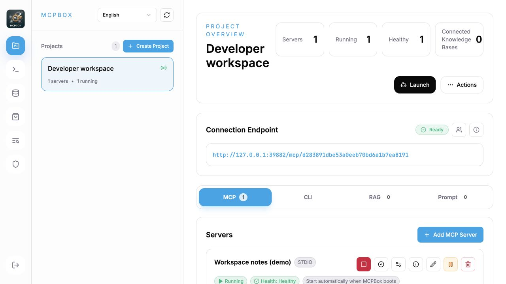
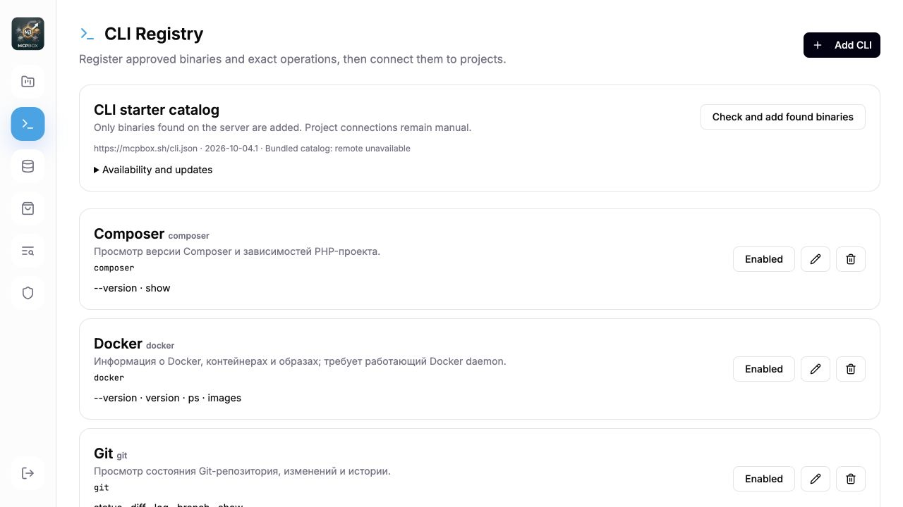

# MCPBox

**Несколько MCP-серверов, CLI-команды и базы знаний — один MCP URL для каждого проекта.**

Управляйте инструментами AI из одной панели: объединяйте их по проектам, настраивайте доступ и проверяйте состояние серверов и историю вызовов. MCPBox — бесплатное приложение с открытым исходным кодом под Apache-2.0, со встроенным веб-интерфейсом и локальным хранением данных.

[Скачать v1.3.0](https://github.com/ArturSaleev/MCPBox/releases/tag/v1.3.0) · [Документация](docs/website/ru/README.md) · [Сайт](https://mcpbox.sh) · [English](README.md)

## Зачем MCPBox

- **Проекты вместо разрозненных конфигов.** Объединяйте локальные `stdio` и удалённые `http_stream` MCP-серверы и подключайте клиент к одному адресу проекта.
- **Контролируемый доступ.** Пользователи, роли, сессии, API-токены, авторизация MCP-подключений и опциональный OIDC SSO.
- **CLI для AI.** Открывайте проекту только разрешённые операции локальных программ и точные наборы аргументов.
- **Знания рядом с инструментами.** Индексируйте документы локально через Bleve или подключайте отдельный RagBox.
- **Понятное состояние.** Проверки здоровья, просмотр tools/resources/prompts, журналы вызовов и базовые метрики.
- **Одна установка.** Go-бинарник со встроенным React UI; для готового релиза Go и Node.js не нужны. Зависимости подключаемых инструментов устанавливаются отдельно.

## Как это работает

Например, создайте проект для работы с кодом: подключите MCP-сервер для файлов, второй сервер для вашей системы задач, разрешите Git `status` и `diff`, добавьте коллекцию документации. Клиент получает единый URL проекта, а MCPBox направляет вызовы нужным инструментам.

```text
AI-клиент → MCP URL проекта → MCP-серверы + разрешённые CLI + база знаний
```

Инструменты выполняются с правами сервисов и системной учётной записи. Промпт проекта не заменяет авторизацию в целевой системе.

## Интерфейс v1.3.0

Снимки из отдельной демонстрационной установки текущего кода: проект с работающим тестовым MCP-сервером и реестр CLI. Порт и данные на снимках демонстрационные; эта установка остановлена после съёмки.

[](images/v1.3.0-projects.jpg)

<details>
<summary>Посмотреть реестр разрешённых CLI-команд</summary>



</details>

## Скачать готовый релиз

Выберите архитектуру своего компьютера. Для macOS Apple Silicon — arm64, для большинства компьютеров Intel/AMD — amd64.

| ОС | Intel / AMD (amd64) | ARM (arm64) |
| --- | --- | --- |
| macOS | [Скачать](https://github.com/ArturSaleev/MCPBox/releases/download/v1.3.0/MCPBox-macos-amd64) | [Скачать](https://github.com/ArturSaleev/MCPBox/releases/download/v1.3.0/MCPBox-macos-arm64) |
| Windows | [Скачать](https://github.com/ArturSaleev/MCPBox/releases/download/v1.3.0/MCPBox-windows-amd64.exe) | [Скачать](https://github.com/ArturSaleev/MCPBox/releases/download/v1.3.0/MCPBox-windows-arm64.exe) |
| Linux | [Скачать](https://github.com/ArturSaleev/MCPBox/releases/download/v1.3.0/MCPBox-linux-amd64) | [Скачать](https://github.com/ArturSaleev/MCPBox/releases/download/v1.3.0/MCPBox-linux-arm64) |

[Все релизы](https://github.com/ArturSaleev/MCPBox/releases) · [Описание v1.3.0](release/RELEASE-1.3.0.md)

## Быстрый старт с бинарником

1. Скачайте файл выше и поместите в отдельную доступную для записи папку. На macOS/Linux переименуйте в `MCPBox`; на Windows — в `MCPBox.exe`.
2. Откройте терминал в этой папке и запустите:

   **macOS / Linux**

   ```bash
   chmod +x MCPBox
   ./MCPBox --mcp-host 127.0.0.1
   ```

   **Windows PowerShell**

   ```powershell
   .\MCPBox.exe --mcp-host 127.0.0.1
   ```

3. В интерактивном терминале следуйте подсказкам для создания первого администратора. Откройте [http://127.0.0.1:38181/](http://127.0.0.1:38181/) и войдите.
4. Создайте проект, добавьте MCP-сервер и проверьте его состояние. Для CLI подключите запись реестра к проекту; для базы знаний — коллекцию.
5. Скопируйте URL `http://127.0.0.1:38182/mcp/<project-token>` из UI и настройте в клиенте MCP HTTP-подключение с авторизацией проекта.

Флаг в примере ограничивает MCP локальной машиной. Без него MCP по умолчанию слушает все IPv4-интерфейсы (`0.0.0.0:38182`); админка — `127.0.0.1:38181`. Для удалённого подключения настройте HTTPS и доступ по [инструкции безопасности](docs/website/ru/production-security.md).

## Подключение AI-клиентов

**Проверенный владельцем проекта сценарий:** локально установленное приложение **Qwen Studio** подключается к MCPBox на той же машине по `http://127.0.0.1:38182/mcp/<project-token>`, с настроенной авторизацией проекта. Tailscale для этого не нужен. Работа веб-версии Qwen Studio не подтверждена. Для облачного ChatGPT нужен публичный HTTPS endpoint; Tailscale Funnel — один из вариантов его получения.

Используйте клиент с поддержкой MCP HTTP и нужного способа авторизации. Установка соединения и успешный вызов инструмента проверяются отдельно для конкретной версии клиента; универсальная совместимость со всеми AI-клиентами не заявляется.

- [ChatGPT: настройка подключения и OAuth](docs/website/ru/chatgpt.md).
- [Проекты, серверы и авторизация](docs/website/ru/projects-marketplace-prompts.md).
- В коде есть launcher для Ollama/llama.cpp и deeplink LM Studio; это вспомогательные способы настройки, а не подтверждение проверки каждой версии этих приложений. [Требования](docs/website/ru/configuration.md).

## Обновление прежних установок

Возможности бывшего MCPBoxPro включены в единый открытый MCPBox; лицензия и активация не требуются. Технические имена `/api/pro/*`, `pro:*` и `MCPBOX_PRO_*` сохранены для совместимости. Перед заменой бинарника прочитайте [миграцию](docs/MERGE.md) и [резервное копирование](docs/website/ru/operations.md).

## Сборка из исходников

Нужны Go 1.26+ и Node.js/npm. Выполните из корня репозитория:

```bash
npm --prefix html ci
npm --prefix html run build
GOWORK=off go build -o MCPBox .
./MCPBox
```

При первом запуске в интерактивном терминале создайте администратора по подсказкам, затем войдите в [админку](http://127.0.0.1:38181/). Для запуска службы без терминала заранее создайте аккаунт:

```bash
./MCPBox admin create --email admin@example.com --password 'replace-with-a-unique-password' --name 'Admin'
```

Пароль — минимум 8 символов. Команда обновляет существующий локальный аккаунт с тем же email; пароль в аргументе может попасть в историю shell и список процессов. Для первого запуска с терминалом предпочтителен интерактивный ввод. В PowerShell используйте `.\MCPBox.exe` вместо `./MCPBox`.

1. Создайте проект в админке.
2. Добавьте MCP-сервер, разрешённую CLI-команду или базу знаний.
3. Проверьте состояние и скопируйте MCP URL проекта из UI.
4. Подключите MCP-клиент с нужным для проекта способом авторизации.

| Интерфейс | По умолчанию |
| --- | --- |
| Admin UI / API | `http://127.0.0.1:38181/` |
| MCP проекта | `http://<server>:38182/mcp/<project-token>` |

MCP слушает `0.0.0.0`; для локального доступа задайте `MCPBOX_MCP_HOST=127.0.0.1`. Порты и адреса меняются через `MCPBOX_HOST`, `MCPBOX_PORT`, `MCPBOX_MCP_HOST`, `MCPBOX_MCP_PORT`. Admin-токены, bearer проекта и PolicyBox runtime-токены имеют разные назначения.

## Данные и обновление

Данные по умолчанию находятся рядом с бинарником: `mcpbox.db`, `package_store/`, `knowledge_base/`, `.mcpboxpro/`. Используйте постоянный каталог с правами записи; `go run` создаёт временный бинарник. Перед заменой установленной версии остановите процесс и сохраните согласованную копию данных. Две базы автоматически не объединяются.

[Обновление и восстановление](docs/website/ru/operations.md) · [Совместимость после объединения](docs/MERGE.md)

## Документация

Полное [оглавление на русском](docs/website/ru/README.md) и [на английском](docs/website/en/README.md).

- [Установка и SSO](docs/website/ru/installation.md)
- [Справочник настроек](docs/website/ru/configuration.md)
- [Проекты, Marketplace и промпты](docs/website/ru/projects-marketplace-prompts.md)
- [CLI](docs/website/ru/cli.md), [базы знаний и интеграции](docs/website/ru/knowledge-integrations.md)
- [ChatGPT](docs/website/ru/chatgpt.md), [API](docs/website/ru/api.md)
- [Безопасность](docs/website/ru/production-security.md), [диагностика](docs/website/ru/troubleshooting.md)
- [Архитектура и разработка](docs/website/ru/development.md), [подробный developer guide](DEVELOPER-ru.md)

Для релиза: установите frontend-зависимости и выполните `./build-release.sh host` или `./build-release.sh all`. Результат: `release/<os>/<arch>/MCPBox/`. Полная документация доступна в репозитории; пакеты релизного скрипта включают бинарник, README и LICENSE.

## Лицензия

[Apache License 2.0](LICENSE). Сервисы RagBox и PolicyBox подключаются отдельно и используют собственные настройки и данные.
