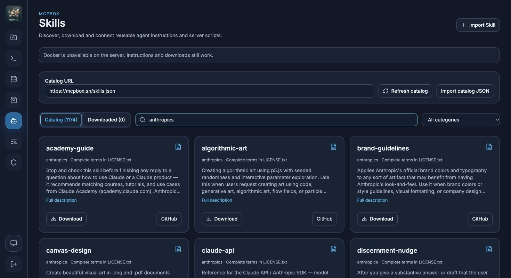
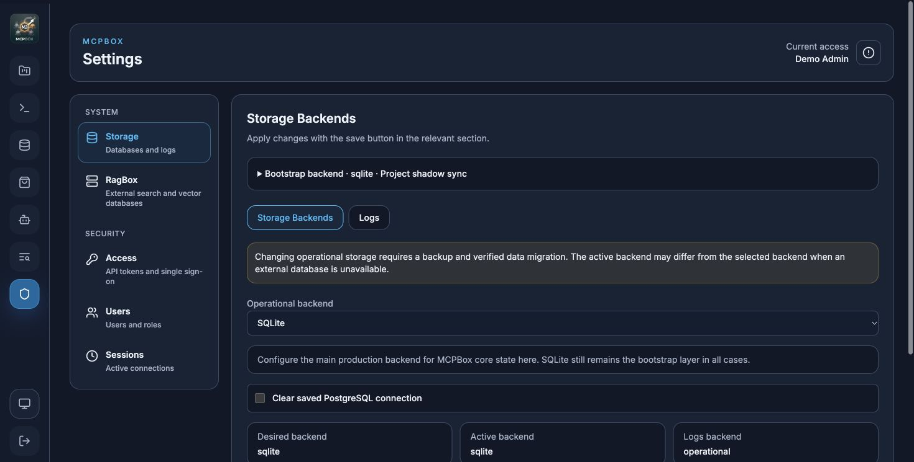

# MCPBox

**MCP servers, CLI commands, knowledge bases and Skills. One MCP URL per project.**

Manage your AI tools from one dashboard: group them into projects, control access, and inspect server health and request history. MCPBox is free, Apache-2.0 open-source software with an embedded web UI and local data storage.

[Download v1.4.0](https://github.com/ArturSaleev/MCPBox/releases/tag/v1.4.0) · [Documentation](docs/website/en/README.md) · [Website](https://mcpbox.sh) · [Community discussions](https://github.com/ArturSaleev/MCPBox/discussions) · [Русский](README-ru.md)

## Why MCPBox

- **Projects instead of scattered configs.** Group local `stdio` and remote `http_stream` MCP servers behind one project URL.
- **Controlled access.** Users, roles, sessions, API tokens, MCP connection authentication and optional OIDC SSO.
- **CLI tools for AI.** Expose only approved local operations and exact argument sets to each project.
- **Skills for projects.** Search the catalog, import GitHub/ZIP packages and connect specific versions with instructions and resources available through MCP.
- **Server-side scripts.** Upload job files and run approved Python, Node.js or Bash scripts in Docker environments prepared by an administrator.
- **Knowledge alongside tools.** Index documents locally with Bleve or connect a separate RagBox service.
- **Visible runtime state.** Health checks, tools/resources/prompts inspection, request logs and basic metrics.
- **One installation.** A Go binary with an embedded React UI; release users do not need Go or Node.js. Connected tools may require their own runtimes.

## How it works

For example, create a coding project: attach a filesystem MCP server and a second server for your task system, allow Git `status` and `diff`, and add a documentation collection. Your client gets one project URL; MCPBox routes calls to the appropriate tools.

```text
AI client → project MCP URL → MCP servers + approved CLI operations + knowledge base + Skills
```

MCP servers and CLI commands run with the permissions of their services and OS account. Project prompts do not replace authorization in the target system.

## Skills: instructions and file processing

1. Open **Skills**, find a catalog package or import one from a public GitHub repository or ZIP. Downloading a package does not execute its scripts.
2. Connect an installed version in the project's **Skills** tab. Clients read instructions through `list_skills`, `get_skill` and `read_skill_file`; Skills tools are exposed only for projects with connected Skills. Clients that cache tools may need their connection refreshed after bindings change.
3. For script execution, an administrator selects the runtime and exact allowed scripts, then prepares a Docker image. Create a job, upload inputs, run an approved script and download results. A path on the client's computer does not transfer the actual file to the server.

Docker is required on the server **only for script execution**; catalog browsing, importing and reading instructions work without it. Jobs run as an unprivileged user with a read-only root filesystem, resource limits and no network by default. Dependency preparation is a separate administrator action that can run build code and access the network. These controls do not guarantee that third-party code is safe: review the package and its license before enabling execution.

[Skills catalog, execution setup and MCP tools](docs/SKILLS.md).

## v1.4.0 interface

Fresh captures from a separate demo installation of the v1.4.0 interface code with test data. The first shows the Skills catalog and search; Docker is unavailable in this installation, so the screenshots do not demonstrate script execution.

[](images/v1.4.0-skills.png)

<details>
<summary>View the refreshed settings</summary>



</details>

v1.4.0 also includes Light, Dark and System themes, a compact Knowledge Base with help and search dialogs, System and Security settings navigation, and project reordering in the sidebar. Theme and project order are remembered in the current browser; project ordering is stored per user.

## Download a release

Choose your computer's architecture: arm64 for Apple Silicon Macs, amd64 for most Intel/AMD computers.

| OS | Intel / AMD (amd64) | ARM (arm64) |
| --- | --- | --- |
| macOS | [Download](https://github.com/ArturSaleev/MCPBox/releases/download/v1.4.0/MCPBox-macos-amd64) | [Download](https://github.com/ArturSaleev/MCPBox/releases/download/v1.4.0/MCPBox-macos-arm64) |
| Windows | [Download](https://github.com/ArturSaleev/MCPBox/releases/download/v1.4.0/MCPBox-windows-amd64.exe) | [Download](https://github.com/ArturSaleev/MCPBox/releases/download/v1.4.0/MCPBox-windows-arm64.exe) |
| Linux | [Download](https://github.com/ArturSaleev/MCPBox/releases/download/v1.4.0/MCPBox-linux-amd64) | [Download](https://github.com/ArturSaleev/MCPBox/releases/download/v1.4.0/MCPBox-linux-arm64) |

[All releases](https://github.com/ArturSaleev/MCPBox/releases) · [v1.4.0 release notes](https://github.com/ArturSaleev/MCPBox/releases/tag/v1.4.0)

[Verify the file SHA-256 before running it](docs/website/en/release-verification.md).

## Quick start with a binary

1. Download a file above into a dedicated writable directory. Rename it to `MCPBox` on macOS/Linux or `MCPBox.exe` on Windows.
2. Open a terminal in that directory and run:

   **macOS / Linux**

   ```bash
   chmod +x MCPBox
   ./MCPBox --mcp-host 127.0.0.1
   ```

   **Windows PowerShell**

   ```powershell
   .\MCPBox.exe --mcp-host 127.0.0.1
   ```

3. In an interactive terminal, follow the prompts to create the first administrator. Open [http://127.0.0.1:38181/](http://127.0.0.1:38181/) and sign in.
4. Create a project, add an MCP server and check its health. For CLI, attach a registry entry to the project; for knowledge, attach a collection; for Skills, connect an installed version.
5. Copy `http://127.0.0.1:38182/mcp/<project-token>` from the UI and configure an MCP HTTP connection in your client with the project's authentication settings.

The example flag keeps MCP local, including on published v1.3.0 binaries whose earlier default is `0.0.0.0:38182`. Current source defaults MCP to `127.0.0.1:38182`; administration defaults to `127.0.0.1:38181`. For remote access, configure HTTPS and authentication following the [security guide](docs/website/en/production-security.md).

## Connect an AI client

**Verified by the project owner:** the locally installed **Qwen Studio application** connects to MCPBox on the same machine at `http://127.0.0.1:38182/mcp/<project-token>`, using the project authentication settings. Tailscale is not needed for this. The Qwen Studio web version has not been verified. Cloud-hosted ChatGPT requires a public HTTPS endpoint; Tailscale Funnel is one option for providing it.

Use a client that supports MCP HTTP and your chosen authentication method. Connection and tool execution need to be verified for the particular client version; this page does not claim universal AI-client compatibility.

- [ChatGPT connection and OAuth setup](docs/website/en/chatgpt.md).
- [Projects, servers and authentication](docs/website/en/projects-marketplace-prompts.md).
- The code includes Ollama/llama.cpp launchers and an LM Studio deeplink. These are setup helpers, not evidence that every version of those applications has been tested. [Requirements](docs/website/en/configuration.md).

## Upgrading an existing installation

Former MCPBoxPro features are included in the unified open-source MCPBox; no license activation is required. Technical names `/api/pro/*`, `pro:*` and `MCPBOX_PRO_*` remain for compatibility. Before replacing the executable, read the [migration notes (RU)](docs/MERGE.md) and [backup procedure](docs/website/en/operations.md).

**v1.4.0 removes the PolicyBox integration.** Legacy identity-verification projects need explicit administrator migration, which rotates the bearer credential and pauses the project for access review. PolicyBox data is preserved. See [migration from PolicyBox](docs/website/en/policybox-migration.md).

## Build from source

Requires Go 1.26.9+ and Node.js/npm. From the repository root:

```bash
npm --prefix html ci
npm --prefix html run build
GOWORK=off go build -o MCPBox .
./MCPBox
```

On first launch in an interactive terminal, follow the prompts to create an administrator, then sign in to the [admin UI](http://127.0.0.1:38181/). Before a non-interactive service launch, create an account explicitly:

```bash
./MCPBox admin create --email admin@example.com --password 'replace-with-a-unique-password' --name 'Admin'
```

Passwords require at least 8 characters. This command updates an existing local account with the same email; command-line passwords may appear in shell history and process listings. Prefer interactive entry for the first terminal launch. On PowerShell use `.\MCPBox.exe` instead of `./MCPBox`.

1. Create a project in the admin UI.
2. Add an MCP server, an approved CLI operation, a knowledge base or a Skill.
3. Check its health and copy the project MCP URL from the UI.
4. Connect an MCP client using the authentication configured for that project.

| Interface | Default |
| --- | --- |
| Admin UI / API | `http://127.0.0.1:38181/` |
| Project MCP | `http://<server>:38182/mcp/<project-token>` |

Current source defaults MCP to `127.0.0.1`. Published v1.3.0 binaries use `0.0.0.0`; explicitly set `MCPBOX_MCP_HOST=127.0.0.1` for those binaries. Override listeners with `MCPBOX_HOST`, `MCPBOX_PORT`, `MCPBOX_MCP_HOST`, `MCPBOX_MCP_PORT`. Admin tokens and project bearer credentials serve different purposes.

## Data and upgrades

Default data lives next to the executable: `mcpbox.db`, `package_store/`, `knowledge_base/`, `skill_store/`, `.mcpboxpro/`. Back up the database and `skill_store/` together: they contain linked Skills metadata, packages, profiles and job files. Use a persistent writable directory; `go run` creates a temporary binary. Stop the process and take a consistent backup before replacing an installed version. Independent databases are not automatically merged.

[Upgrade and recovery](docs/website/en/operations.md) · [Merge compatibility notes (RU)](docs/MERGE.md)

## Documentation

Full guides in [English](docs/website/en/README.md) and [Russian](docs/website/ru/README.md).

- [Installation and SSO](docs/website/en/installation.md)
- [Configuration reference](docs/website/en/configuration.md)
- [Projects, Marketplace and prompts](docs/website/en/projects-marketplace-prompts.md)
- [Skills: catalog, MCP and script execution](docs/SKILLS.md)
- [CLI](docs/website/en/cli.md), [knowledge bases and integrations](docs/website/en/knowledge-integrations.md)
- [ChatGPT](docs/website/en/chatgpt.md), [API](docs/website/en/api.md)
- [Security](docs/website/en/production-security.md), [troubleshooting](docs/website/en/troubleshooting.md)
- [Architecture and development](docs/website/en/development.md), [detailed developer guide](DEVELOPER.md)

For releases, install frontend dependencies then run `./build-release.sh host` or `./build-release.sh all`. Output: flat `release/MCPBox-<os>-<arch>` files (`.exe` for Windows) and `release/SHA256SUMS`. macOS uses `macos` in asset names. The manifest covers only the current run; use `all` for a complete release. Documentation and LICENSE remain in the repository.

## Community, contributing and security

Join [GitHub Discussions](https://github.com/ArturSaleev/MCPBox/discussions) to ask questions, suggest features, share MCP integrations and Skills, or show what you've built with MCPBox. You can also follow project announcements there.

- **Questions and ideas:** [GitHub Discussions](https://github.com/ArturSaleev/MCPBox/discussions).
- **Reproducible bugs:** [GitHub Issues](https://github.com/ArturSaleev/MCPBox/issues).
- **Code contributions:** [Contributing guide](CONTRIBUTING.md).
- **Security vulnerabilities:** [Report privately](SECURITY.md); do not publish secrets or vulnerability details in Issues or Discussions.

English and Russian are welcome.

## License

[Apache License 2.0](LICENSE). RagBox is an optional integration with its own configuration and data.
